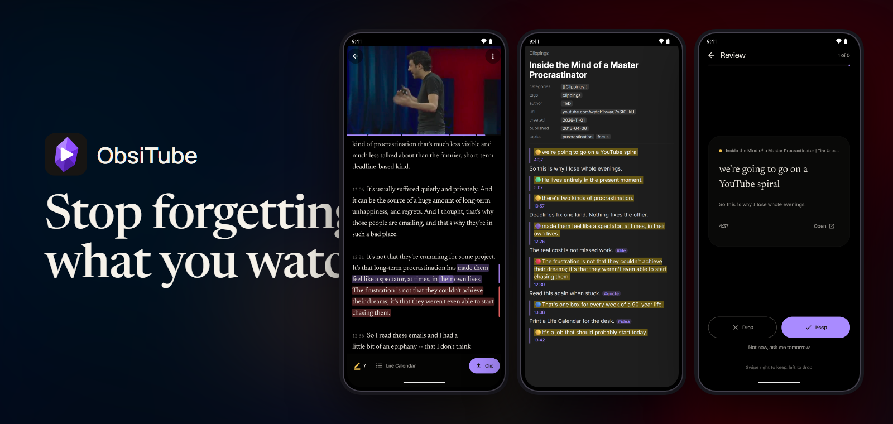
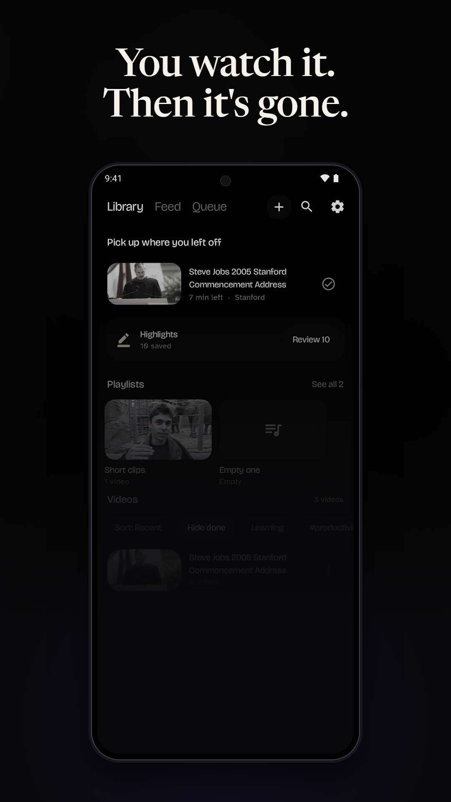
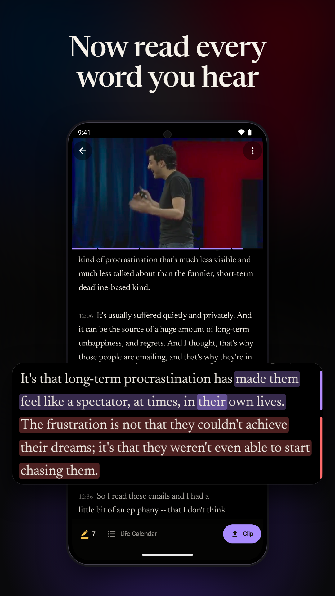
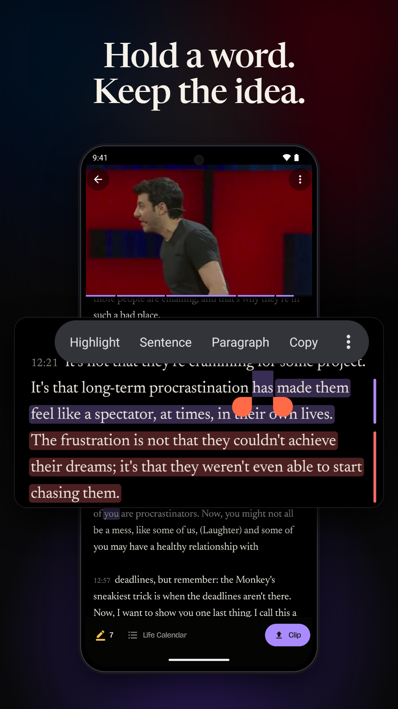
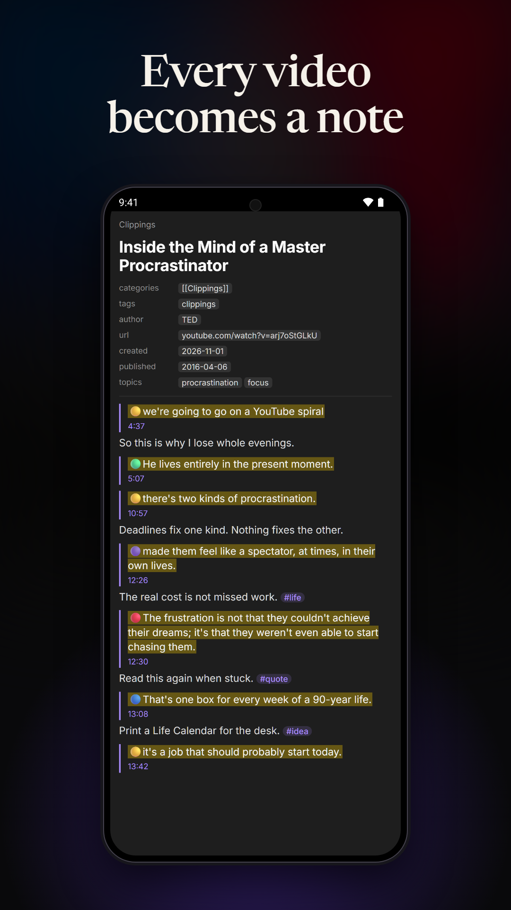
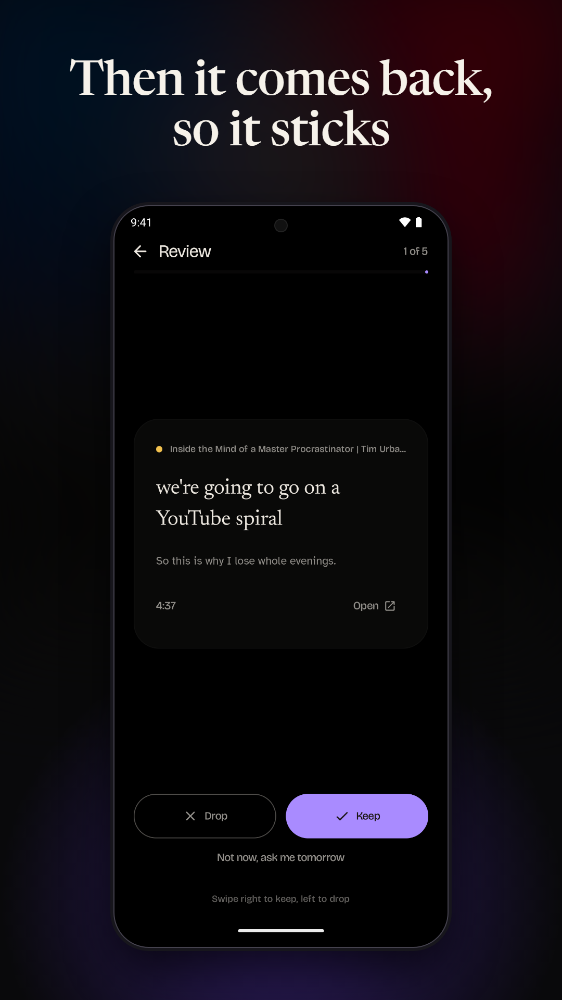
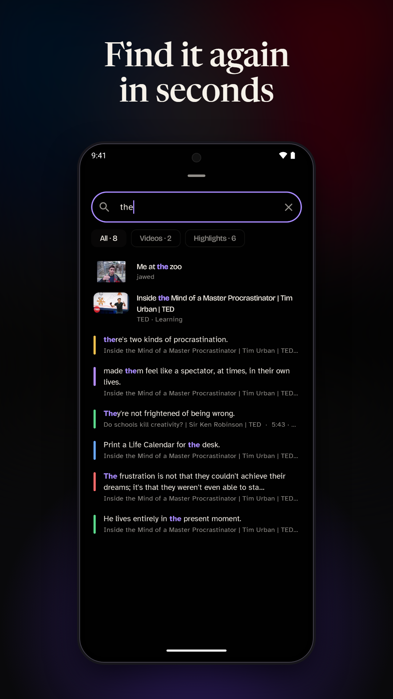

<p align="center">
  
</p>

<p align="center">
  <a href="../../releases/latest"></a>
  
  
  <a href="LICENSE"></a>
  
</p>

<p align="center">
  <b>Stop forgetting what you watch.</b><br>
  You spend hours on YouTube. A week later, it is gone. ObsiTube turns a video into words you can read, keep and see again.
</p>

<p align="center">
  <a href="../../releases/latest"><b>Download the latest APK</b></a>
</p>

---

## How it works

<table>
  <tr>
    <td width="33%"></td>
    <td width="33%"></td>
    <td width="33%"></td>
  </tr>
  <tr>
    <td width="33%"></td>
    <td width="33%"></td>
    <td width="33%"></td>
  </tr>
</table>

1. **Read.** The transcript follows the video, word by word.
2. **Keep.** Hold a word to highlight it, and add your own thought.
3. **Save.** One tap makes a clean note in your Obsidian vault.
4. **Remember.** Old highlights come back in short Review rounds.
5. **Find.** Search your highlights, notes, titles and tags.

## Features

### Read

| | |
|---|---|
| **Add a video** | Paste a link, share from the YouTube app, or tap any YouTube link. |
| **Play it your way** | Audio or video, in the background, with full screen and a media notification. |
| **Follow along** | The spoken word is marked as it plays, in real selectable text. |
| **Highlight** | Take exact words, a sentence or a paragraph, in six colours, with a note and tags. |
| **Review** | Old highlights come back in short rounds, with a daily reminder if you want one. |
| **Lock screen** | Keep reading along with the phone locked. |

### Organize

| | |
|---|---|
| **Pick up where you left off** | Your last videos, newest first, with the time left. |
| **Mark as done** | Tap the tick, swipe a row, or watch to the end. Undo is one tap away. |
| **Queue and playlists** | Line up what is next, or import a YouTube playlist. |
| **Channels and feed** | Follow channels and see what is new. |
| **Search** | Look through titles, channels, tags, highlights and your notes. |

### Clip to Obsidian

| | |
|---|---|
| **Your vault templates** | Pick a note from your vault. ObsiTube reads its properties and sets them up. |
| **Every property type** | Automatic, Checkbox, Date, Date & time, List, Number and Text. |
| **Video data** | See what the app knows about a video, with real examples, and choose where it goes. |
| **Ask me every time** | Mark a property and its box shows on the save screen. If you leave it empty, it asks before the note saves. |
| **Values you already use** | Each box offers what that property already has in your vault. |
| **Two-way sync** | Change a vault template in the app or in Obsidian, and the other side follows. |
| **Your vault, searched** | Pick folders, tags and notes with fuzzy search. |
| **Safe updates** | If the video is already in your vault, updating only adds. Your writing stays. |
| **Web Clipper** | Import and export Obsidian Web Clipper settings. |

### Make it yours

| | |
|---|---|
| **Six app icons** | Amethyst, Ruby, Sapphire, Emerald, Amber and Classic. |
| **Themes** | Ready-made palettes, a palette maker, and Light, Dusk, Dark and OLED. |
| **Reading** | Your font, text size, line height and line length. |

## Using a template from your vault

1. Open **Settings > Obsidian** and tap **From my vault**.
2. Pick your template. ObsiTube looks in the folder set in Obsidian's Templates plugin.
3. Each property is set up from its name and from your vault's property types.
4. Tap a property to choose its type and what goes in it.

| Choice | What it does |
|---|---|
| **Ask me** | A box opens before the note saves. |
| **Video data** | Fills in by itself from the list of video data. |
| **Always the same** | Puts the same text in every note. It can mix in tags like `{{title}}`. |
| **Leave empty** | Keeps the property with no value. |

Pick the same template again after you change it in Obsidian. New properties are added, and your choices stay.

### Video data

`title` `author` `url` `published` `date` `description` `fullDescription` `image` `duration` `minutes` `seconds`
`highlights` `highlightCount` `transcript` `words` `chapters` `tags` `category` `videoId` `embed` `site` `content`

Obsidian's `{{date}}`, `{{time}}` and `{{date:FORMAT}}` work in templates. So do Web Clipper filters such as `{{title|lower}}`.

## Build

You need JDK 21 and the Android SDK, platform 36.

```bash
JAVA_HOME=/path/to/jdk-21 ./gradlew assembleRelease
```

Run the unit tests:

```bash
./gradlew testDebugUnitTest
```

Run them against the real YouTube:

```bash
YT_LIVE=1 ./gradlew testDebugUnitTest
```

## Releases

Write `docs/releases/v<version>.md`, then run `scripts/release.ps1 -Version <version>`. GitHub Actions builds and publishes the APK.

A daily workflow looks for a newer NewPipe Extractor. If both the tests and a release build pass, it publishes a patch release. The app then shows an update pop-up.

## How it stays working

- Playback has four tiers: YouTube's app clients, NewPipe Extractor, Piped and Invidious. One broken source is not fatal.
- Captions use the same mobile calls as YouTube's own apps. You can change client versions in Settings, Advanced.
- Templates are plain data.

## Stack

Kotlin, Jetpack Compose, Material 3 Expressive, Media3 and NewPipe Extractor.

## Licence

ObsiTube is free software under the [GNU General Public License v3.0](LICENSE). It uses NewPipe Extractor, which is also GPL-3.

ObsiTube is not affiliated with Obsidian or YouTube.
